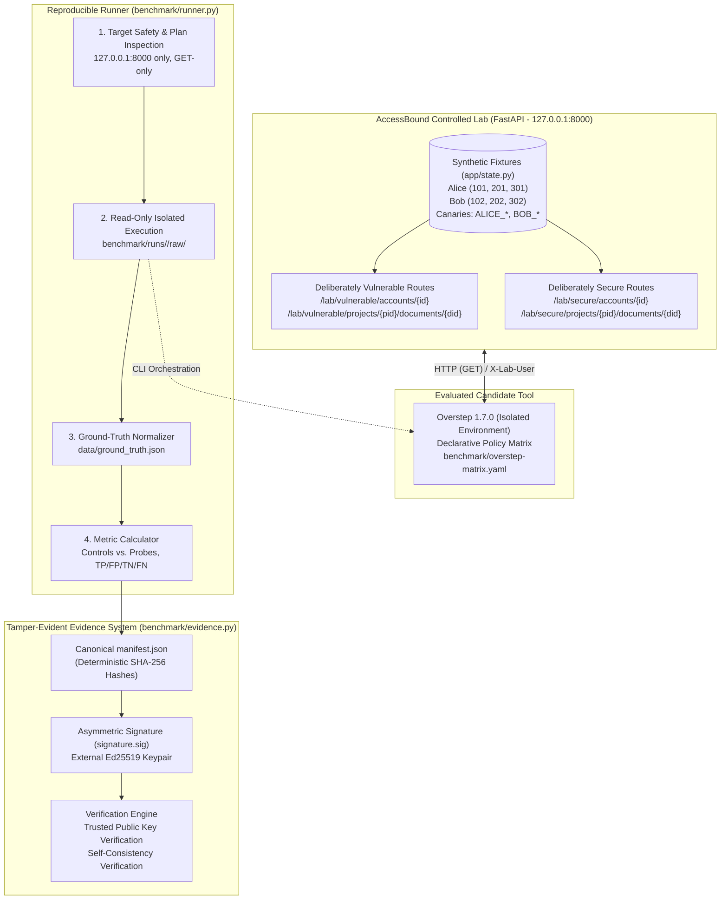

# AccessBound — API Authorization Benchmark & Evidence Lab

AccessBound is a **controlled research lab and benchmark harness** for evaluating API authorization-testing tools against known, verifiable ground-truth outcomes. It intentionally pairs deliberately vulnerable and secure endpoints in a local-only environment to measure scanner precision, recall, and false-positive rates with cryptographic evidence integrity.

> **Tool Distinction**: AccessBound is the controlled benchmark lab and evaluation harness. [Overstep](https://github.com/kabiri-labs/overstep) (v1.7.0) is the third-party declarative authorization test engine evaluated against it. AccessBound does not claim to be the first or only API authorization evaluation lab, but provides an open, repeatable, and tamper-evident evaluation methodology.

---

## Architecture Overview



---

## Current Status & Test Suite

The project includes 40 automated tests passing with zero failures across three test modules:

1. **Ground-Truth Tests (`tests/test_ground_truth.py`)**: 19 tests verifying positive controls, deliberate BOLA vulnerabilities, secure boundaries, owner checks, admin checks, missing identity rejection, and parent/child relationship integrity.
2. **Cryptographic Evidence Tests (`tests/test_evidence.py`)**: 8 tests verifying manifest canonicalization, SHA-256 file hashing, Ed25519 signature validation, hash mismatch detection, manifest tampering detection, path traversal rejection, and untracked file detection.
3. **Benchmark Runner Tests (`tests/test_runner.py`)**: 13 tests verifying out-of-scope target rejection, prerequisite failure halting, run directory isolation, unsigned bundle handling, metric denominator isolation, full lifecycle execution order, 16-case plan extraction, non-GET method rejection, truncated plan rejection, and missing resource detection.

---

## Safety, Ethics, and Limitations

- **Local Training Code Only**: This repository contains deliberately vulnerable authorization logic for local research and education. Bind only to `127.0.0.1:8000`. Do not deploy to public servers or clouds.
- **Simulated Identity**: The `X-Lab-User` header simulates authenticated test sessions (`alice`, `bob`, `admin`). It is **not** authentication; production systems must derive identity from cryptographically validated sessions or tokens.
- **Synthetic Data**: All account IDs, balances, document titles, and canary strings are fictional test fixtures (`ALICE_CANARY_ACCOUNT_101`, `BOB_CANARY_ACCOUNT_102`, etc.).
- **Declarative vs. Autonomous Scanner Metrics**: The 100% precision and recall metrics achieved by Overstep reflect its adherence to an explicitly specified declarative policy matrix. They do **not** imply that a black-box, autonomous vulnerability scanner would automatically achieve identical metrics without human policy definition.

---

## Setup & Clean Reproduction (Windows PowerShell)

### Prerequisites
- Python 3.10+ (tested on Python 3.11.9)
- Windows PowerShell

### 1. Lab and Core Test Environment Setup

```powershell
# Create virtual environment for AccessBound
py -m venv .venv

# Activate environment (or use direct python binary if script execution is restricted)
.\.venv\Scripts\Activate.ps1

# Upgrade pip and install core lab dependencies
python -m pip install --upgrade pip
pip install -r requirements.txt

# Run full test suite (40 tests)
pytest -v -W default
```

*Note: Running the core lab and pytest suite does not require installing Overstep into `.venv`.*

### 2. Candidate Tool Setup (Separate Environment)

To avoid dependency conflicts and ensure clean tool isolation, Overstep is installed in a separate virtual environment:

```powershell
py -m venv .venv-overstep
.\.venv-overstep\Scripts\python.exe -m pip install --upgrade pip
.\.venv-overstep\Scripts\python.exe -m pip install overstep==1.7.0
```

### 3. Signing Key Setup (External to Repository)

Generate an Ed25519 signing keypair outside the repository for tamper-evident bundles:

```powershell
# Create external key directory in user profile
New-Item -ItemType Directory -Force -Path "$env:USERPROFILE\.accessbound\keys"

# Generate Ed25519 keypair
.\.venv\Scripts\python.exe -m benchmark.evidence keygen `
    --priv "$env:USERPROFILE\.accessbound\keys\lab_signer.private.pem" `
    --pub "$env:USERPROFILE\.accessbound\keys\lab_signer.public.pem"
```

> **Security Rule**: Private signing keys must **never** be committed to Git. The `.gitignore` excludes `*.key`, `*.private.pem`, and `private_key.pem`, while allowing public keys (`!public_key.pem`) for verification.

---

## Running the Reproducible Benchmark

### Step 1: Start the Local Lab API
In terminal 1:
```powershell
.\.venv\Scripts\python.exe -m uvicorn app.main:app --host 127.0.0.1 --port 8000
```
*API documentation is available locally at `http://127.0.0.1:8000/docs`.*

### Step 2: Execute the Benchmark Runner
In terminal 2:
```powershell
.\.venv\Scripts\python.exe -m benchmark.runner `
    --signing-key "$env:USERPROFILE\.accessbound\keys\lab_signer.private.pem" `
    --trusted-public-key "$env:USERPROFILE\.accessbound\keys\lab_signer.public.pem"
```

The runner automatically:
1. Validates that the target is strictly `127.0.0.1:8000`.
2. Runs the full pytest test suite (40 tests).
3. Validates the Overstep matrix structurally and against the live API.
4. Performs dry-run plan inspection (verifies exactly 16 read-only `GET` cases).
5. Executes Overstep in `--read-only` mode, saving raw artifacts to a unique `benchmark/runs/<run-id>/raw/` directory.
6. Maps findings to ground-truth catalog IDs (`AB-BOLA-001..006`, `AB-NESTED-001..004`).
7. Calculates confusion matrix metrics separating positive controls from negative probes.
8. Packages a tamper-evident evidence bundle (`benchmark/runs/<run-id>/bundle/`), signs the canonical manifest, and verifies the bundle integrity against the external public key.

---

## Benchmark Results & Metrics Summary

| Evaluation Dimension | Milestone 2 Baseline | Milestone 3 & 5 Verified Run |
|---|---|---|
| **Scope** | Account BOLA | Account & Nested Document BOLA |
| **Resources Evaluated** | 2 | 4 |
| **Total Test Executions** | 8 | 16 |
| **Legitimate Positive Controls (`self`)** | 4 (All passed `200 OK`) | 8 (All passed `200 OK`) |
| **Negative Authorization Probes (`other`)** | 4 (`AB-BOLA-001, 002, 005, 006`) | 8 (`AB-BOLA-*` + `AB-NESTED-001..004`) |
| **True Positives (TP)** | 2 | 4 |
| **True Negatives (TN)** | 2 | 4 |
| **False Positives (FP)** | 0 | 0 |
| **False Negatives (FN)** | 0 | 0 |
| **Unique Code Defects Detected** | 1 (`vulnerable_read_account`) | 2 (`vulnerable_read_account`, `vulnerable_read_nested_document`) |
| **Precision** | 100% (2 / 2) | 100% (4 / 4) |
| **Recall** | 100% (2 / 2) | 100% (4 / 4) |
| **False Positive Rate (FPR)** | 0% (0 / 2) | 0% (0 / 4) |

### Unsupported and Deferred Scenarios
- **Unsupported (`AB-NESTED-005`, `AB-NESTED-006`)**: Parent/child relationship integrity (querying Project 201 with Document 302 returns `404 Not Found`). Verified by ground-truth tests, but cannot be generated by Overstep's declarative matrix model.
- **Deferred (`AB-BFLA-001`, `AB-BFLA-002`)**: Admin reporting function-level authorization endpoints (`POST /lab/vulnerable/admin/reports`). Deferred because mutating operations are excluded under read-only evaluation policy.

---

## Verifying Cryptographic Evidence Bundles

Evidence bundles use deterministic canonical JSON serialization (`canonicalize_manifest`), SHA-256 file hashes, and Ed25519 digital signatures.

### 1. Trusted Verification (External Public Key)
Verifies that the bundle has not been altered and was signed by the specific trusted key:
```powershell
.\.venv\Scripts\python.exe -m benchmark.evidence verify benchmark/runs/<run-id>/bundle `
    --trusted-public-key "$env:USERPROFILE\.accessbound\keys\lab_signer.public.pem"
```
Output:
```text
[PASS] Bundle verification succeeded: signature verified and 5 evidence files intact
  Run ID:    run-20261014-185014
  Timestamp: 2026-10-14T18:50:20.461905+00:00
  Files:     5 verified
```

### 2. Self-Consistency Verification (Bundled Public Key)
Verifies internal bundle consistency without out-of-band trust:
```powershell
.\.venv\Scripts\python.exe -m benchmark.evidence verify benchmark/runs/<run-id>/bundle
```

> **Public Key Fingerprint**: The manifest metadata records the SHA-256 fingerprint of the signer's public key (e.g., `487461557a51f039...`). This fingerprint serves as an identifier for key tracking; trusted verification requires checking against an independently stored, trusted public key.

---

## Demonstration Checklist

- [ ] **1. Clean Environment**: Clone repository, create `.venv`, install `requirements.txt`.
- [ ] **2. Test Suite**: Run `pytest -v -W default` (all 40 tests pass).
- [ ] **3. Tool Isolation**: Verify `.venv-overstep` has `overstep 1.7.0` and `.venv` does not require `overstep`.
- [ ] **4. Target Safety**: Attempt to run runner with non-local target (e.g. `--target http://example.com:8000`); verify immediate rejection before network execution.
- [ ] **5. Start Lab API**: Run `uvicorn app.main:app --host 127.0.0.1 --port 8000`.
- [ ] **6. Run Benchmark**: Execute `python -m benchmark.runner` with signing keys. Verify raw artifacts and evaluation summary in `benchmark/runs/<run-id>/`.
- [ ] **7. Cryptographic Verification**: Run `benchmark.evidence verify` using `--trusted-public-key`.
- [ ] **8. Tamper Detection**: Modify a single byte in `evidence/findings.json`; rerun verify and observe immediate `[FAIL] Hash mismatch`.

---

## Repository Layout

```text
app/                            # FastAPI application and seeded synthetic state
├── main.py                     # Deliberately vulnerable and secure endpoint pairs
└── state.py                    # Seeded test fixtures with synthetic canary markers
benchmark/                      # Benchmark test matrices, runner, and evidence
├── README.md                   # Detailed benchmark methodology and results
├── comparison-report.md        # Comparative analysis across milestones
├── evidence.py                 # Tamper-evident bundle creation, verification & keygen
├── overstep-matrix.yaml        # Active Overstep policy matrix
├── runner.py                   # Automated reproducible benchmark runner
├── bundles/                    # Preserved baseline signed evidence bundles
│   ├── milestone-2-account-bola/
│   └── milestone-3-nested-bola/
├── results/                    # Preserved baseline raw execution outputs
│   └── milestone-3-run-001/
└── runs/                       # Isolated timestamped benchmark runner outputs
    └── run-20261014-185014/
data/                           # Ground-truth catalog
└── ground_truth.json           # Machine-readable test case specifications
tests/                          # Automated regression and integrity tests
├── test_ground_truth.py        # 19 ground-truth endpoint tests
├── test_evidence.py            # 8 cryptographic evidence bundle tests
└── test_runner.py              # 13 benchmark runner workflow tests
requirements.txt                # Core lab dependencies
.gitignore                      # Private key and local environment exclusions
```
